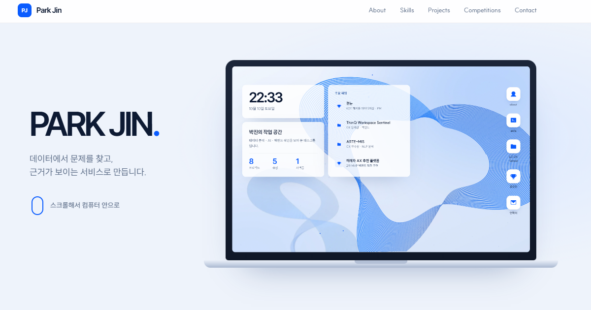

# 박진 포트폴리오

**AI와 함께 데이터를 다루는 개발자, 박진입니다.**
데이터에서 문제를 찾고, 근거가 보이는 서비스로 만듭니다.

🔗 **https://parkjin0821-portfolio.netlify.app**



## 컨셉: 화면 속으로 다이브

스크롤 한 번에 한 장면씩, 노트북 화면 안으로 들어가며 작업을 보여줍니다.

| 장면 | 내용 |
|---|---|
| 노트북 | 뚜껑이 열리며 시작합니다. 화면 속에는 실제 바탕화면이 떠 있습니다 |
| 바탕화면 | 시계, 작업 요약(프로젝트 8 · 수상 5 · 자격증 1), 주요 작업 바로가기 |
| About | 소개, 전공, 교육, 자격 |
| Skills | 터미널 창에 기술 스택이 입력되고, 옆 창에 자격증 정보가 뜹니다 |
| Projects | 파일 탐색기 속 LG DX School 프로젝트 4개. 카드를 열면 문서 페이지로 펼쳐집니다 |
| 공모전 | 문서 뷰어 속 4개 사례를 페이지처럼 넘겨 봅니다 |
| 연락 | 노트북 뚜껑이 닫히며 마무리됩니다 |

## 담긴 작업

**LG DX School 5기**
- 실시간 HR 인력 대시보드 (AX)
- ThinQ 클로이드 홈 매니저 (BX) — 우수상
- ARTE-MIS (CX) — 우수상
- ThinQ Workspace Sentinel (DX) — 장려상

**공모전**
- 곁눈 — KDT 해커톤 아이디어상. 공식 문서 1,052건, 근거 검색 성공률 83.3%
- 미래차 AX 추천 플랫폼 — 공공데이터 11종, API 테스트 31/31 통과 (2차 MVP 직접 구현)
- 전력설비 화재위험 예측 — 날씨 빅데이터 콘테스트. 전주 데이터 138만 건
- AILAGro — AI 아이디어 공모전 우수상 (아이디어·발표자료, 구현 없음)

## 기술 스택

- **Backend & API**: Python · FastAPI · PostgreSQL · AWS · Git
- **Data & AI**: Pandas · NumPy · scikit-learn · R · RAG
- **AI 활용**: ChatGPT · Claude Code · Codex. 구현은 AI와 함께, 설계·검증·운영 판단은 직접 합니다.

## 사이트 구현

프레임워크 없이 HTML · CSS · JavaScript로 만들었습니다.

- 장면 전환은 한 화면을 다른 화면 속 창이나 노트북 화면에 정확히 겹쳐 확대하는 방식입니다. 움직이는 값은 `transform`과 `opacity`뿐이라 전환 중에도 끊기지 않습니다.
- 마우스 휠 한 칸이나 방향키 한 번이 장면 하나로 이어집니다.
- 화면이 좁거나 낮으면(1024×640 미만) 다이브 대신 위에서 아래로 읽는 레이아웃으로 바뀝니다.

## 폴더 구성

```text
portfolio-concept-dive/      현재 사이트 (배포 시 이 폴더를 사이트 루트로 빌드)
├─ index.html · dive.css · dive.js
├─ assets/                   이미지 (WebP)
└─ reports/                  곁눈 데이터 리포트
공모전/ · LG DX SCHOOL/ · KDT 해커톤/web/   사이트가 링크하는 발표자료·보고서 PDF
index.html · css/ · js/ · assets/          이전 디자인 (Space Journey)
```

로컬에서 보려면 저장소 루트에서 서버를 띄우고 `/portfolio-concept-dive/`로 접속합니다. 자료 링크가 `../` 경로를 쓰기 때문입니다.

```bash
python -m http.server 8321
```

→ http://localhost:8321/portfolio-concept-dive/

## 연락

- Email: parkjin8326@gmail.com
- GitHub: [Parkjin0821](https://github.com/Parkjin0821)
- Notion: [Portfolio archive](https://shade-egret-c5a.notion.site/PortFolio-2d96029496a28095b8e6d6a7db5b8208)
